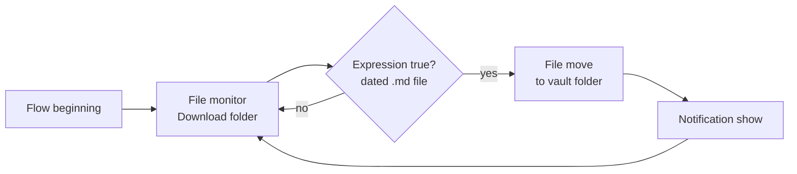

# Android: file downloads automatically

Without the [Make route](make-setup.md), a phone save ends in a download. The free app [Automate](https://llamalab.com/automate/) can move those downloads into the vault for you:



- **File monitor**: path `/storage/emulated/0/Download`, events *Writable file closed* and *File moved to*, output path into variable `path`.
- **Expression true?**:
  ```
  matches(path, ".*/[0-9][0-9][0-9][0-9]-[0-9][0-9]-[0-9][0-9][ _][^/]*[.]md")
  ```
  Avoid `{4}` and backslashes: Automate treats `{…}` in text as an inline expression and handles backslashes differently, so the usual regex shorthand silently never matches.
- **File move**: to `/storage/emulated/0/Documents/MyVault/Conversations/`.
- Grant Automate "All files access" and exclude it from battery optimization.

Notes land in the default folder this way, not in project folders.

Back to the [README](../README.md).
