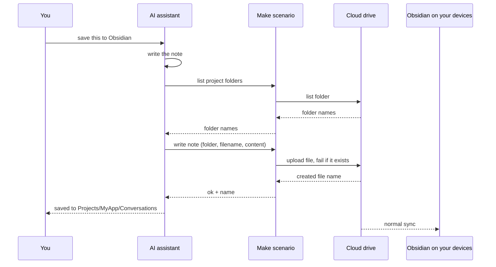

# Setting up the Make route

[Make](https://www.make.com) is an automation platform. Here it acts as a small, private bridge: the assistant calls a Make scenario, and the scenario writes the note into the cloud drive your vault syncs with. This is what makes direct saving work from the phone apps (see [Why mobile is the hard part](why-mobile-is-hard.md)).

You don't have to do this alone: once the skill is installed, say *"help me set up the Make route"* and the assistant walks you through these steps.

## What it costs

- **Free for this purpose.** Make's free plan currently includes 1,000 credits per month and up to 2 active scenarios. One module run uses roughly one credit, and one save needs about 3 to 9 (a folder listing, the upload, occasionally a retry), so the free plan covers roughly a hundred saves or more per month. Check [make.com/pricing](https://www.make.com/en/pricing) for the current numbers.
- **You need:** a Make account, a connection from Make to your cloud drive, one scenario, and the **Make connector** enabled in your AI assistant.
- **Supported drives:** OneDrive, Google Drive and Dropbox. iCloud Drive and Obsidian Sync have no Make integration; on those setups the skill uses a linked computer, a download or copyable Markdown instead.

## Step 1: Create a Make account

Sign up at [make.com](https://www.make.com). The free plan is enough.

## Step 2: Connect your cloud drive

In Make, open **Connections › Add**, choose **OneDrive**, **Google Drive** or **Dropbox**, and sign in with the account your vault syncs with.

## Step 3: Build the scenario

Pick the guide for your drive:

| Drive | Guide | Variant |
| --- | --- | --- |
| OneDrive | [make/onedrive](../make/onedrive/README.md), with an importable blueprint | `onedrive-api-shell` |
| Google Drive | [make/google-drive](../make/google-drive/README.md), built module by module | `vault-bridge` |
| Dropbox | Same shape as Google Drive but simpler, since Dropbox uses paths: a folder-listing module for `list` and an upload module with overwriting turned off for `write` | `vault-bridge` |

## Step 4: Scenario settings

- **Scheduling: On demand.** Only on-demand scenarios are offered to AI assistants.
- **Active:** switch the scenario on.
- **Inputs and outputs** defined as in the guide for your drive.
- **Description:** write a clear one, e.g. *"Lists folders and writes Markdown notes in my Obsidian vault on OneDrive."* The assistant sees it as the tool description.
- **Name:** keep it short; it becomes part of the tool name the assistant sees.
- **Data is confidential:** switch it on, so note contents aren't kept in the scenario's run history.

## Step 5: Connect Make to your assistant

- **Claude:** *Settings › Connectors*, add **Make**, sign in, choose your organization. The free plan grants the scope "Run your scenarios", which is all this needs. Then enable the connector in the chat's tools menu.
- **ChatGPT:** add Make under apps/connectors, sign in, and enable it for the conversation.
- Other assistants that support MCP connectors can use Make's MCP server the same way.

Your assistant may ask for permission before each scenario run. That is expected. After connecting, start a new chat so the scenario shows up as a tool.

## Step 6: Test

Say *"save this to Obsidian"* in a short test chat, then check that the note appears in Obsidian on another device. If it works, the assistant sets `make.enabled: true` and the scenario name in your [configuration](../skills/save-conversation-to-obsidian/references/config-schema.md).

## Security and privacy

- Your conversation content passes through Make on its way to your drive. With **Data is confidential** on, Make doesn't keep the contents in the run history. For very sensitive chats, prefer saving from a computer.
- The OneDrive API shell can do anything your OneDrive connection allows. Use the [path filter](../make/onedrive/README.md#optional-safety-filter) to limit it to the vault.
- The configuration contains no secrets. Make and your drive authenticate through their own sign-in, which you can revoke at any time.

If something doesn't work, see [Troubleshooting](troubleshooting.md). Back to the [README](../README.md).
