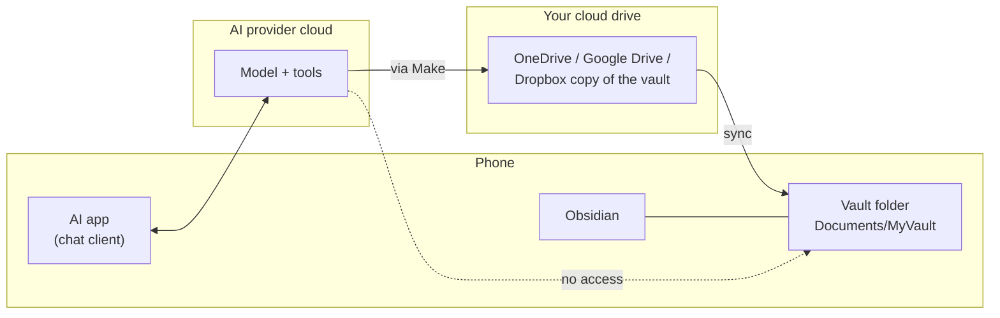

# Why mobile is the hard part

On a computer, an AI agent can simply write a file. On a phone it can't, and that is not a missing setting:

- **The model doesn't run on your phone.** The Claude, ChatGPT and Gemini apps are clients. The model and its tools (code execution, file creation, connectors) run on the provider's servers. When the assistant "creates a file", it creates it in a sandbox in the cloud, and the app offers it to you as a download.
- **Android keeps apps out of each other's folders.** Since *scoped storage* (Android 10/11), an app can only see its own storage. To write into a folder such as `Documents/MyVault`, an app must either let you pick that folder through Android's folder picker (*Storage Access Framework*) and then use it deliberately, or hold the special "All files access" permission, which Google Play only allows for certain app types such as file managers. The AI apps do neither, so no permission tool or setting can give them access; there is no code in the app that would use it.
- **iOS is similar.** Apps are sandboxed; files reach other apps through the share sheet and the Files app, never by an app writing into another app's folder.

That leaves three ways for a note to reach the vault from a phone, and the skill uses all of them:

1. **Through a computer** that has the vault (route B), which needs the computer to be on.
2. **Through the cloud drive the vault syncs with** (route C). The model can't reach your phone, but it can reach OneDrive, Google Drive or Dropbox through Make, and your normal sync does the rest.
3. **Through you**: a download or copy (routes D and E), optionally automated.

If you run a coding agent inside Termux on Android, it does have real file access (route A), but it can only save its own sessions, not chats from the AI apps.

Back to the [README](../README.md).
