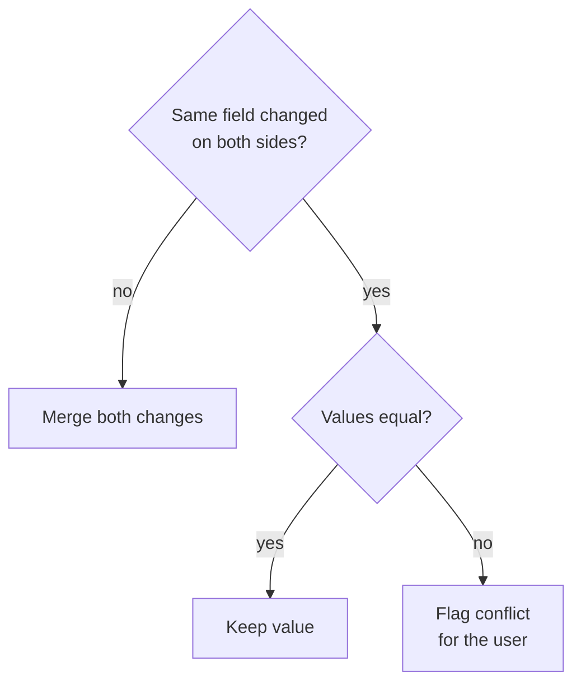
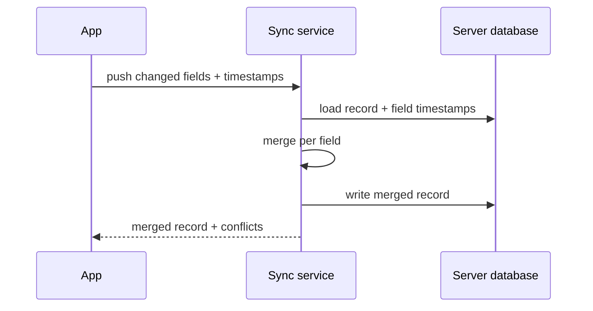

# Sync Conflict Fix

## Summary
Edits made while the app was offline were silently overwritten after reconnecting. We traced this to the sync service's last-writer-wins rule, which compares only the record's `updated_at` timestamp and ignores which fields actually changed. We replaced it with a field-level merge that keeps non-conflicting changes from both sides and flags true conflicts for the user. The fix is implemented and covered by tests; existing conflict records still need a migration.

## Key decisions
- **Field-level merge instead of last-writer-wins.** Keeps offline edits to different fields.
- **Real conflicts go to the user.** When both sides change the same field, the app shows both versions instead of guessing.
- **Per-field timestamps kept in a separate table.** Avoids a schema change on every synced table.

### Decision flow


## Action items
- [ ] Add a migration for existing conflict records
- [ ] Show a conflict badge in the note list
- [ ] Load-test the merge with 10k records

## Workflow
Every sync now compares the per-field timestamps of the local and remote record before writing.



## Commands
### Run the sync tests
```bash
npm test -- sync/merge
```

### Apply the new migration locally
```bash
npm run db:migrate
```

## Code & configuration
### Merge rule
```ts
export function mergeField(local: Field, remote: Field): Field | Conflict {
  if (local.value === remote.value) return local;
  if (local.changedAt === remote.changedAt) return { conflict: [local, remote] };
  return local.changedAt > remote.changedAt ? local : remote;
}
```

## Files
### Created
- `src/sync/merge.ts` — field-level merge
- `migrations/0042_field_timestamps.sql` — per-field timestamp table
### Modified
- `src/sync/service.ts` — uses the merge instead of last-writer-wins

## Commits
| Commit | Message | Repo / branch | Status |
| --- | --- | --- | --- |
| [`3f9c2a1`](https://github.com/example/myapp/commit/3f9c2a1) | Replace last-writer-wins with field-level merge | example/myapp · main | pushed |
| `8b01d7e` | Add field timestamp migration | example/myapp · main | local |

## Links
### Vault notes
- [[MyApp Dashboard]] — project overview
### External
- [Conflict-free replicated data types](https://en.wikipedia.org/wiki/Conflict-free_replicated_data_type) — background on merge strategies

## Session usage
| Metric | Value |
| --- | --- |
| Model | claude-opus-5-5 |
| Input tokens (est.) | ~110k, mostly cached |
| Output tokens (est.) | ~10k |
| Cost (est.) | ~$0.60 (API-equivalent) |
| Basis | chars÷4 heuristic; vendor pricing page, 2026-09-27 |
