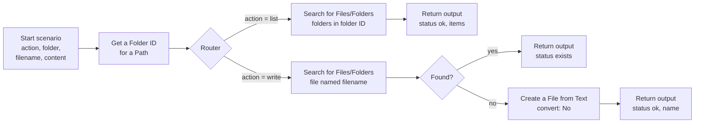

# Make scenario for Google Drive

Google Drive works with folder IDs, not paths, so its scenario does a little more and offers two simple actions to the assistant: `list` and `write`.

| # | Module | Settings |
| --- | --- | --- |
| 1 | **Scenarios › Start scenario** | inputs: `action` (Text, required), `folder` (Text, required), `filename` (Text), `content` (Text) |
| 2 | **Google Drive › Get a Folder ID for a Path** | Drive: My Drive; Folder Path: `/Obsidian/MyVault/{{1.folder}}` (your vault's path in Drive) |
| 3 | **Router** | route "list": filter `action` = `list`; route "write": filter `action` = `write` |
| 4 (list) | **Google Drive › Search for Files/Folders** | Enter manually; Retrieve: Folders; Folder ID: `{{2.id}}` |
| 5 (list) | **Array aggregator** (source: module 4) → **Scenarios › Return output** | `status` = `ok`, `items` = the aggregated names |
| 4 (write) | **Google Drive › Search for Files/Folders** | Enter manually; Retrieve: Files; Folder ID: `{{2.id}}`; Search within names, exact term: `{{1.filename}}`; Limit 1 |
| 5 (write) | **Router** or filters | *found*: **Return output** with `status` = `exists`; *not found*: continue |
| 6 (write) | **Google Drive › Create a File from Text** | My Drive; location: map `{{2.id}}`; File Name `{{1.filename}}`; Content `{{1.content}}`; **Convert to Google Docs: No** |
| 7 (write) | **Scenarios › Return output** | `status` = `ok`, `name` = `{{6.name}}` |

Scenario outputs: `status` (Text), `name` (Text), `items` (Array of text), `message` (Text).

Notes:

- The target folders must exist. Create `Conversations` folders once in Obsidian, or extend the write route with **Create a Folder** when module 2 finds nothing.
- Keep "Convert to Google Docs" off, or Obsidian receives a Google Doc instead of a Markdown file.
- For search modules that may return nothing, enable "continue on no results" or use a filter on the bundle count, so the "not found" branch runs.

Set `make.variant: vault-bridge` in the configuration.

> This scenario is documented from Make's module definitions. If a module label or option differs in your Make editor, please open an issue or pull request.

Back to the [Make setup guide](../../docs/make-setup.md).
